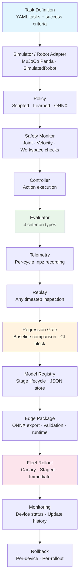

# Forge

Forge is a robotics reliability platform for validating, debugging, and deploying robot policies from simulation to edge devices. It provides reproducible task benchmarks, telemetry replay, fault injection, regression gates, model versioning, edge packaging, fleet rollout, safety monitoring, and sim-to-real utilities. The goal is to answer a production robotics question: *Can we prove that a robot policy is still safe and effective after it changes and is deployed to multiple robots?*

## Architecture



## What Is Genuinely Implemented

This table separates what Forge actually does from what it could do. Every claim maps to a specific source file and test coverage.

### Tier 1 — Implemented and tested (384 tests, CI on every push)

| Capability | Source | Details |
|---|---|---|
| MuJoCo Menagerie Panda simulation | `forge_core/simulation.py` | Mesh collision, accurate Franka kinematics, headless rendering |
| YAML task definitions | `forge_core/task.py`, `forge_core/evaluator.py` | 4 criterion types: position threshold, height threshold, gripper state, time limit |
| Scripted pick-and-place policy | `forge_core/policy.py` | Deterministic waypoint sequence; succeeds on `pick_red_cube` in 5.1s sim time |
| Per-cycle telemetry recording | `forge_core/recorder.py` | Joint state, end-effector pose, object positions, actions stored as `.npz` |
| Replay at any timestep | `forge_core/replay.py` | Load any recorded run, inspect state at arbitrary cycle |
| 6-type fault injection | `forge_core/faults.py` | YAML fault profiles, composable faults, compare mode (see Fault Types below) |
| Camera perception | `forge_core/perception.py` | MuJoCo offscreen render, HSV color detection, depth-based 3D unprojection |
| Behavioral cloning training | `forge_core/learned_policy.py` | PyTorch MLP, configurable architecture (default: `[256, 256, 128]`, 31 obs → 8 act) |
| Experiment tracking | `forge_core/experiment.py` | JSON per experiment: config, metrics, git commit, tags. Zero external deps |
| Model registry with stage lifecycle | `forge_core/model_registry.py` | Stages: training → validated → production → archived. Single-file JSON store |
| Regression detection | `forge_core/regression.py` | Baseline comparison, configurable metric tolerance (default: 10%), CI gate |
| ONNX export + validation + inference | `forge_core/edge_deploy.py` | ONNX opset 17, PyTorch↔ONNX output validation, `OnnxPolicy` runtime |
| GitHub Actions CI | `.github/workflows/ci.yml` | Python 3.10/3.11 matrix, headless MuJoCo (`MUJOCO_GL=egl`) |
| Regression CI gate | `.github/workflows/regression.yml` | Blocks merge on performance degradation |

### Tier 2 — Implemented with simulated adapters

| Capability | Source | What's simulated |
|---|---|---|
| Hardware abstraction layer | `forge_core/hardware.py` | `RobotInterface` ABC exists but **only `SimulatedRobot` is implemented** — no physical robot drivers |
| Safety monitoring | `forge_core/safety.py` | Joint limit, velocity limit, workspace boundary checks — **applied to simulated commands only** |
| Fleet device registry | `forge_core/fleet.py` | Local JSON file (`fleet/devices.json`) — no network, no concurrent access |
| OTA update system | `forge_core/ota.py` | Packages, rollouts, history all stored as local JSON — **no actual network deployment** |
| Sim-to-real utilities | `forge_core/sim2real.py` | Domain randomization on MuJoCo model, trajectory comparison and calibration — **all with synthetic data** |

### Tier 3 — Prototype (code exists, not fully functional)

| Capability | Status |
|---|---|
| TensorRT optimization path | Code in `edge_deploy.py` but TensorRT is never installed — tested only for the unavailable-library path |
| Vision-based policy (`obs_mode='vision'`) | Raises `NotImplementedError` |
| ROS 2 nodes (`ros2_ws/`) | Optional nodes exist; not covered by the 384-test suite |

### Tier 4 — Future / production work

| Capability | Migration path |
|---|---|
| Physical robot drivers | Implement `RobotInterface` for real arms (UR, Panda libfranka, etc.) |
| Production registries | PostgreSQL for experiments/models, S3/GCS for artifacts |
| Certified safety system | Hardware e-stop, watchdogs, formal risk assessment |
| Cloud infrastructure | Artifact registry, message broker, device management service |
| Vision policies | Complete the `obs_mode='vision'` path with image-based observations |

## Benchmark Results

### Baseline task performance

Baseline results from `baselines/manipulation-v1.json` using the scripted pick-and-place policy:

| Task | Result | Sim Time | Notes |
|---|---|---|---|
| `pick_red_cube` | ✅ SUCCESS | 5.1s | Policy reaches target position within threshold |
| `pick_blue_cube` | ❌ FAILURE | 30.0s | Timeout — scripted policy is tuned for red cube position only |
| `pick_red_cube_spread` | ❌ FAILURE | 30.0s | Timeout — spread layout places cube outside scripted waypoints |

The scripted policy is intentionally narrow: it validates the evaluation pipeline on one task, and the failures on the other two demonstrate that the benchmark catches real limitations.

### Fault injection impact

Representative results from simulation runs with the 6 fault types:

| Fault Type | Injected Condition | Expected Impact |
|---|---|---|
| `object_moved` | Cube teleported mid-run | Policy reaches wrong position; task fails |
| `sensor_noise` | Gaussian noise on joint readings | Slight trajectory deviation; may still succeed |
| `sensor_delay` | Stale state for N cycles | Delayed response; overshoot on fast motions |
| `actuator_stuck` | Specific joints frozen | Arm cannot reach target; task fails |
| `controller_dropout` | All commands zeroed | Robot goes limp; immediate failure |
| `gravity_shift` | Gravity vector changed | Objects drift; grasp timing breaks |

### ML training configuration

From `config/training.yaml`:

| Parameter | Value |
|---|---|
| Architecture | MLP `[256, 256, 128]` |
| Observation dim | 31 (joint pos + joint vel + EE pose + object pos) |
| Action dim | 8 (7 joints + gripper) |
| Epochs | 100 |
| Batch size | 64 |
| Learning rate | 0.001 |
| Validation split | 10% |

### Edge inference

`OnnxPolicy.benchmark()` measures inference latency. ONNX Runtime on CPU typically yields sub-millisecond inference for this model size (31→8 through three hidden layers). Actual numbers depend on hardware — run `forge_deploy.py --benchmark` to measure on your machine.

### Regression detection

The regression gate (default threshold: 10% from `config/regression.yaml`) compares new evaluation results against stored baselines.

Example scenario: if `pick_red_cube` sim time increases from 5.1s to 6.0s (18% regression), the gate blocks the change. A 5% increase to 5.35s would pass. The regression CI workflow (`regression.yml`) runs this check automatically on pull requests.

## Limitations and Roadmap

### Intentional prototype choices

Forge uses **JSON-based file storage** for experiments, model registry, fleet state, and OTA data. This is a deliberate design choice to keep the project self-contained and dependency-light:

| Limitation | Impact | Production alternative |
|---|---|---|
| No concurrent-write safety | Single-user only | PostgreSQL or managed database |
| No transactional guarantees | Partial writes on crash | Database transactions |
| Limited querying | Linear scan of JSON files | SQL queries, indexed storage |
| No access control | Anyone with file access can modify | IAM, role-based access |
| Poor multi-site scalability | Everything is local | Object storage (S3/GCS), artifact registry |
| Limited auditability | No structured audit log | Append-only event log, observability platform |

### Hardware limitations

- **`SimulatedRobot` is the only `RobotInterface` implementation.** No physical robot has been connected or validated.
- The hardware abstraction layer is designed for extension, but hardware abstraction is not validated hardware integration.
- If asked in an interview: describe this as a *hardware-ready abstraction with simulation support*, not as physical robot integration.

### Safety scope

Forge's `SafetyMonitor` is a **software safety-monitoring layer**, not a certified safety system. See the Safety Architecture section for details.

### Roadmap

| Priority | Item |
|---|---|
| 1 | Physical robot driver (implement `RobotInterface` for a real arm) |
| 2 | PostgreSQL-backed experiment and model storage |
| 3 | Object storage for artifacts and telemetry |
| 4 | Complete vision-based policy path |
| 5 | Hardware safety integration (e-stop, watchdog) |
| 6 | Cloud deployment infrastructure |
| 7 | TensorRT optimization with actual GPU testing |

## Safety Architecture

### What SafetyMonitor does (`forge_core/safety.py`)

The `SafetyMonitor` performs three checks before every command is sent to the robot:

| Check | Config source | Limits |
|---|---|---|
| **Joint position limits** | `config/safety.yaml` | 7-joint Panda bounds (e.g., J1: ±2.9 rad) |
| **Velocity limits** | `config/safety.yaml` | Per-joint max velocity (2.2–2.6 rad/s) |
| **Workspace boundary** | `config/safety.yaml` | XY: ±1.0m, Z: 0.0–1.5m |

On violation: the monitor logs the violation, flags the command as unsafe, and delegates to `emergency_stop()`.

### What production robot safety additionally requires

Forge's safety module covers software-level command validation. A production-deployed robot requires significantly more:

- **Emergency-stop hardware integration** — physical e-stop button wired to motor power
- **Watchdog timers** — hardware watchdog that stops the robot if software hangs
- **Communication-loss handling** — safe behavior when control link drops
- **Collision detection** — force/torque sensing or external monitoring
- **Power and braking behavior** — controlled deceleration, brake engagement on power loss
- **Safe-state transitions** — defined recovery states after fault detection
- **Operator permissions** — role-based access to robot control modes
- **Hardware interlocks** — physical guards, light curtains, safety-rated sensors
- **Formal risk assessment** — ISO 10218, ISO/TS 15066 compliance documentation

Position Forge's safety as what it is: a software pre-check layer that validates commands before execution, useful for development and simulation, but not a substitute for certified robot safety systems.

## Quick Start

### Prerequisites

- Ubuntu 22.04 or 24.04
- Python 3.10+
- ROS 2 Humble or Jazzy (optional — all evaluation works without ROS)

### Install

```bash
pip install -e '.[dev,ml]'       # core + pytest + PyTorch
pip install -e '.[dev,ml,edge]'  # also include ONNX/ONNXRuntime
```

### Verify

```bash
python3 -m pytest tests/ -v       # 384 tests, no ROS needed
python3 scripts/forge_doctor.py   # health check
```

### Core workflows

```bash
# Evaluate a task
python3 scripts/forge_eval.py --task pick_red_cube
python3 scripts/forge_eval.py --suite manipulation-v1

# Record and replay
python3 scripts/forge_eval.py --task pick_red_cube --record
python3 scripts/forge_replay.py runs/run_00001/

# Chaos testing
python3 scripts/forge_chaos.py --task pick_red_cube --fault object_moved
python3 scripts/forge_chaos.py --task pick_red_cube --fault cascading --compare

# Perception
python3 scripts/forge_perception.py --scenario basic_workspace --detect --annotate -o detections.png

# Train a learned policy
python3 scripts/forge_train.py --task pick_red_cube --episodes 5
python3 scripts/forge_eval.py --task pick_red_cube --policy learned --model-path models/bc_policy.pt

# Experiment and model registry
python3 scripts/forge_registry.py experiments list
python3 scripts/forge_registry.py models promote bc_pick_red_cube --version 1 --stage validated

# Regression testing
python3 scripts/forge_regression.py --create-baseline --suite manipulation-v1
python3 scripts/forge_regression.py --check --suite manipulation-v1

# Edge deployment
python3 scripts/forge_deploy.py --export --model models/bc_policy.pt --output models/bc_policy.onnx
python3 scripts/forge_deploy.py --validate --model models/bc_policy.onnx --checkpoint models/bc_policy.pt
python3 scripts/forge_deploy.py --benchmark --model models/bc_policy.onnx --n-iterations 200
python3 scripts/forge_deploy.py --package --model models/bc_policy.onnx --output deploy/ --name bc_pick_red_cube

# Fleet and OTA
python3 scripts/forge_fleet.py devices register --id arm-01 --name "Panda Arm 01" --type panda
python3 scripts/forge_fleet.py ota create-package --source-dir deploy/bc_policy/ --version 1.0.0 --model-name bc_pick
python3 scripts/forge_fleet.py ota deploy --package-id pkg_00001 --target-group production
python3 scripts/forge_fleet.py ota rollback --rollout-id rollout_00001 --force

# Robot (simulated)
python3 scripts/forge_robot.py connect --type simulated --scenario basic_workspace
python3 scripts/forge_robot.py safety-check

# ROS 2 (optional)
python3 scripts/run_forge.py
ros2 topic echo /forge/joint_states --once
```

## Contributing and Development

### Prerequisites

| Dependency | Version | Required |
|---|---|---|
| Python | ≥ 3.10 | Yes |
| mujoco | ≥ 3.1.0 | Yes |
| numpy | ≥ 1.24.0 | Yes |
| PyYAML | ≥ 6.0 | Yes |
| opencv-python-headless | ≥ 4.8.0 | Yes |
| pytest | ≥ 7.0 | Dev |
| torch | ≥ 2.0 | ML features |
| onnx | ≥ 1.14.0 | Edge deployment |
| onnxruntime | ≥ 1.15.0 | Edge deployment |

### Setup

```bash
git clone <repo-url> && cd forge
pip install -e '.[dev,ml]'
python3 -m pytest tests/ -v        # all 384 tests should pass
python3 scripts/forge_doctor.py    # verify environment
```

### Project structure

```
forge_core/          22 modules — core library, zero ROS dependency
scripts/             12 CLI tools (eval, chaos, replay, train, deploy, fleet, etc.)
tests/unit/          23 test files (unit tests)
tests/integration/   1 acceptance test
config/              7 YAML configs (training, regression, safety, deploy, fleet, robot, default)
tasks/               4 task YAMLs + 1 suite definition
faults/              5 fault profiles
baselines/           1 baseline JSON (manipulation-v1)
docs/                architecture.md + setup.md
ros2_ws/             Optional ROS 2 nodes (not required for core functionality)
```

### Code conventions

- **Type hints** throughout — all function signatures are annotated
- **Dataclasses** for structured data, **ABCs** for interfaces
- **stdlib logging** — no custom logging framework
- **Docstrings** on public classes and methods
- **No ROS dependency** in `forge_core/` — ROS nodes are isolated in `ros2_ws/`
- Tests use **pytest fixtures** with `tmp_path` for isolation

## How to Explain Forge

### 30-second pitch

> I built Forge as a reliability and deployment platform for ML-powered robots. Instead of only training a policy in simulation, Forge lets me define measurable tasks, run policies, record and replay trajectories, inject realistic failures, detect regressions in CI, export models for edge inference, and manage staged fleet updates with rollback support. I designed it around the problems that appear after a robot leaves the notebook: reproducibility, debugging, safety, deployment, and operational reliability.

### Interview walkthrough order

1. **Problem** — Robotics teams struggle to validate changes consistently after a policy leaves research.
2. **Core loop** — Task definition → execution → evaluation → telemetry → replay.
3. **Reliability** — Fault injection with 6 failure types and regression baselines.
4. **ML lifecycle** — Behavioral cloning, experiment tracking, model registry with stage promotion.
5. **Production path** — ONNX export, edge packaging, fleet OTA with canary/staged rollout.
6. **Safety** — Software limit checks on joint position, velocity, and workspace boundaries.
7. **Trade-offs** — Local JSON storage and simulated hardware were chosen to keep the project reproducible and dependency-light.
8. **Next step** — Replace local registries with production services and validate on real hardware.

## Fault Types

| Type | Effect |
|---|---|
| `object_moved` | Teleport an object to a new position mid-run |
| `sensor_noise` | Gaussian noise on joint position readings |
| `sensor_delay` | Return stale robot state for N cycles |
| `actuator_stuck` | Freeze specific joints at current value |
| `controller_dropout` | Zero all commands — robot goes limp |
| `gravity_shift` | Change gravity vector mid-run |

## Documentation

- [Architecture](docs/architecture.md) — system design across all modules
- [Setup Guide](docs/setup.md) — installation, usage, and CLI reference

## License

MIT
